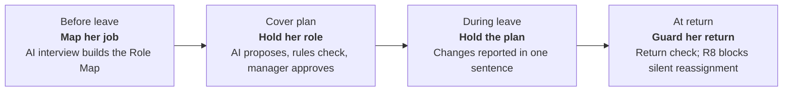
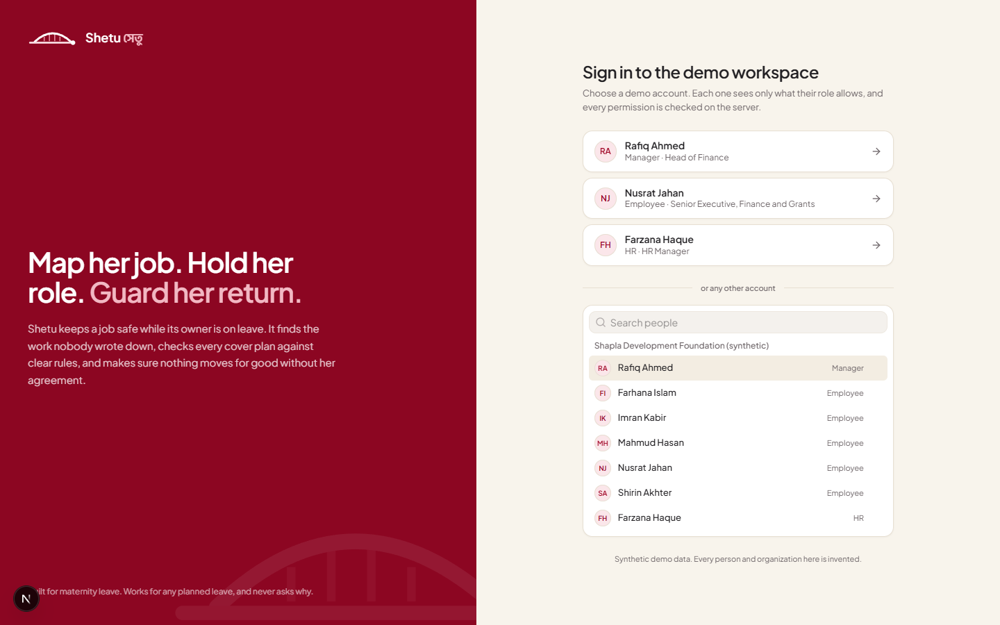
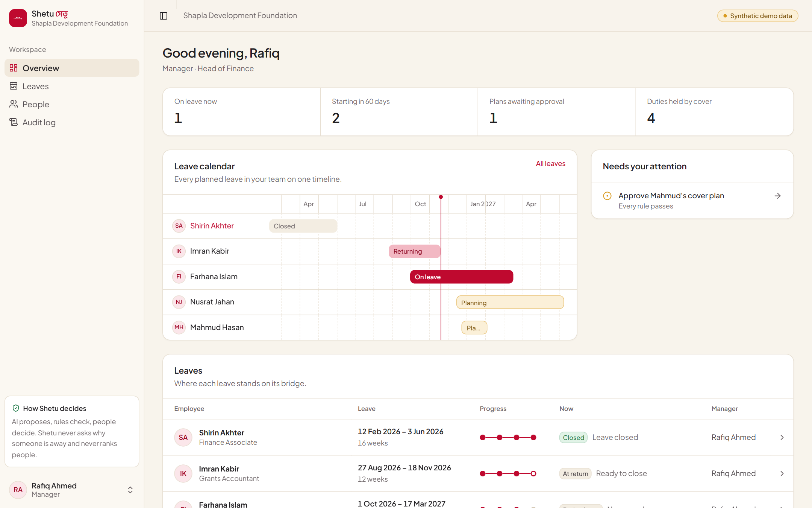
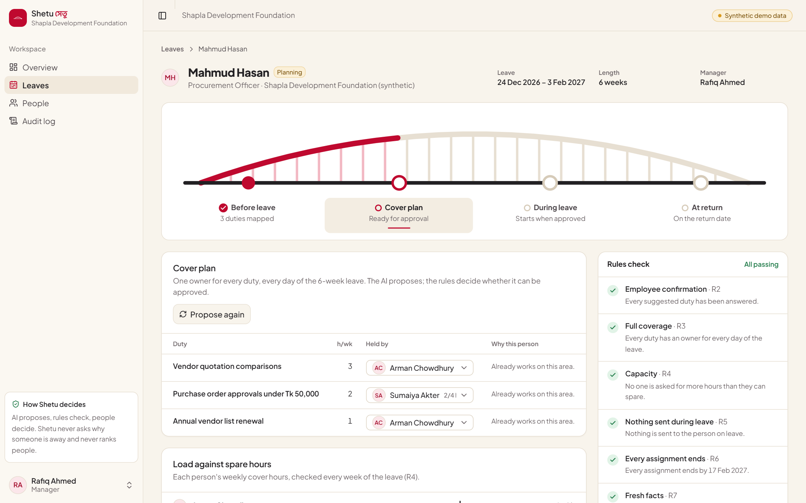
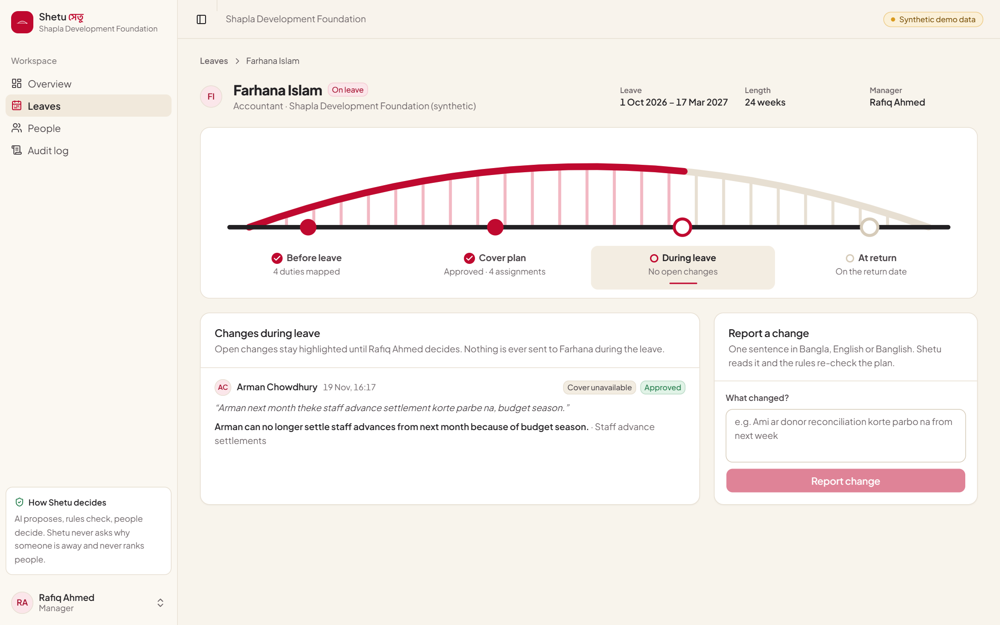
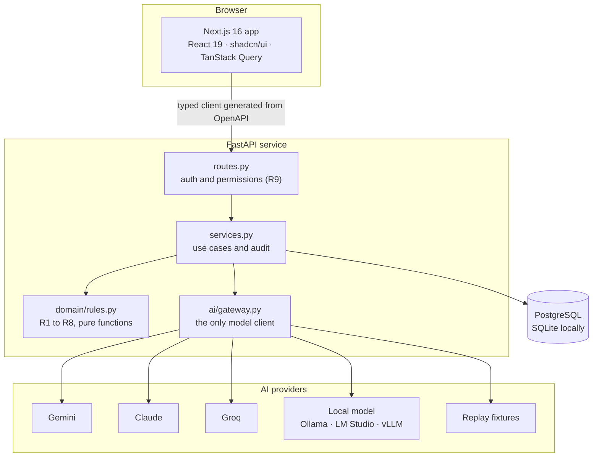
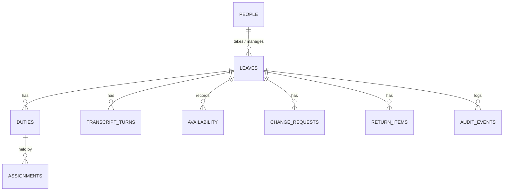

<p align="center">
  
</p>

<h1 align="center">Shetu <sub>সেতু</sub></h1>

<p align="center">
  <b>Map her job. Hold her role. Guard her return.</b><br>
  Shetu keeps a job safe while its owner is on leave.
</p>

<p align="center">
  <a href="https://github.com/tonni19/shetu-congress/actions/workflows/ci.yml"></a>
  
  
  
  
  
  
</p>

<p align="center">
  Team Anomaly · United International University · International AI Builders Congress 2026 (Idea to Unicorn)<br>
  Domain: InfraSphere · Challenge: Human+AI
</p>

---

## Table of contents

- [Overview](#overview)
- [The problem](#the-problem)
- [How Shetu works](#how-shetu-works)
- [Screenshots](#screenshots)
- [Features](#features)
- [The rules engine](#the-rules-engine)
- [How the AI is used](#how-the-ai-is-used)
- [Architecture](#architecture)
- [Tech stack](#tech-stack)
- [Getting started](#getting-started)
- [Configuration](#configuration)
- [Choosing an AI provider](#choosing-an-ai-provider)
- [Using the demo](#using-the-demo)
- [Project structure](#project-structure)
- [API reference](#api-reference)
- [Data model](#data-model)
- [Testing and quality](#testing-and-quality)
- [Deployment](#deployment)
- [Privacy, safety and ethics](#privacy-safety-and-ethics)
- [Roadmap](#roadmap)
- [Contributing](#contributing)
- [Team](#team)
- [AI and data disclosure](#ai-and-data-disclosure)
- [License](#license)

---

## Overview

Every long leave creates two worries. The employee worries that her job will not be hers when she comes back. Her manager worries that the work will not get done while she is away. Today the usual answer is a handover document and hope.

**Shetu** turns a planned leave into one shared, checked plan that runs from the first day of planning to the day the leave closes:

1. **Before leave**, an AI interview in Bangla, English or Banglish finds the work nobody wrote down and builds a **Role Map**: every duty with its evidence.
2. **During leave**, a **cover plan** gives every duty an owner for every day. The AI proposes it, deterministic rules check it, and the manager approves it.
3. **At return**, a **return check** shows what goes back to her, what changed while she was away, and blocks the leave from closing while anything has moved to someone else for good without her agreement.

Shetu is designed around maternity leave, the longest and highest-stakes planned leave, and works for any planned leave of two weeks or more. **It never asks why someone is away**: there is no field for the reason, health or family, so the software cannot tell and does not need to.

> **AI proposes, rules check, people decide.** The model reads, asks and drafts. Code decides dates, hours, coverage and capacity. A person approves.

---

## The problem

| What goes wrong today | Who pays for it |
|---|---|
| Duties that live only in someone's head are never handed over: a monthly reconciliation for one donor, an approval only she gives, the bank contact who calls only her | The organization, through missed deadlines and audit findings |
| Cover plans are made in a meeting and nobody checks whether the people covering actually have the time | Colleagues, who quietly absorb the overload |
| Temporary cover slowly becomes permanent, and the person returns to a smaller job | The employee, most often a mother returning from maternity leave |
| Nobody keeps a record of who agreed to what | HR, when a dispute or audit arrives |

Shetu does not manage day-to-day work and is not a workload balancer. It manages **what happens to a job while its owner is away, and how that job comes back.**

---

## How Shetu works



| Stage | Who acts | What the AI does | What the code decides |
|---|---|---|---|
| Before leave | Employee | Asks one question at a time; extracts duties with exact quotes | R1 quote check, R2 her confirmation |
| Cover plan | Manager | Proposes a colleague for each duty, with a reason | R3 coverage, R4 capacity, R5 nothing sent to her, R6 every assignment ends, R7 fresh facts |
| During leave | Manager, covering colleagues | Turns a one-sentence report into a structured change | Re-checks the plan; the manager approves or rejects |
| At return | Employee, manager | Explains the comparison in Bangla and English | R8: nothing moves for good without her agreement |

Three roles are always named in the same order: **the employee is the person Shetu protects, the manager is the person who uses it most, and the organization is the customer.**

---

## Screenshots

> All people, organizations and figures in the screenshots are synthetic.

| Sign in | Manager overview |
|---|---|
|  |  |

| Cover plan with rule checks | During leave, a change waiting for a decision |
|---|---|
|  |  |

---

## Features

**For the employee**
- Interview in Bangla, English or Banglish; one question at a time, about 15 minutes
- Role Map where every duty shows its evidence: *said* (with her exact words), *documented* (from the job description) or *suggested* (a question until she answers)
- Confirms or removes each duty; nothing suggested counts until she says so
- At return, decides whether a duty stays with a colleague or comes back, with an explanation in both languages
- Is never contacted during leave

**For the manager**
- Overview with the team's leave calendar, a "needs your attention" queue and every leave's stage
- One-click cover proposal with a reason for each assignment
- One-tap availability questions, asked only about the people proposed and only when planning
- A live rules inspector; approval unlocks only when every rule passes
- Load bars showing each person's weekly cover hours against their spare hours
- Changes during leave reported in one sentence and decided in one click

**For HR and the organization**
- An audit log of every proposal, answer, approval and decision
- People directory showing cover held, never a score or ranking
- One engine for every planned leave and every team

**Platform**
- Role-based access checked on the server for every request
- Pluggable AI: Gemini, Claude, Groq, or a **local model** so company data never leaves the organization's machines
- Replay mode with recorded AI replies, for tests and offline demos
- Typed end to end: the web client's types are generated from the API's OpenAPI spec

---

## The rules engine

Every rule is a pure Python function in [`apps/api/src/shetu_api/domain/rules.py`](apps/api/src/shetu_api/domain/rules.py) with unit tests for passing, failing and boundary cases. The model never decides any of them.

| Rule | Name | Checks |
|---|---|---|
| **R1** | Quote check | A duty marked "said" quotes words that really appear in the interview (after Unicode normalization). Otherwise it is downgraded to "suggested" and flagged |
| **R2** | Her confirmation | Suggested duties count only after the employee confirms them |
| **R3** | Full coverage | Every confirmed duty has an approved owner for every day of the leave; gaps are reported by date |
| **R4** | Capacity | No cover person carries more weekly hours than they said they can spare, checked week by week |
| **R5** | No work sent to her | Nothing is assigned to the person on leave while she is away |
| **R6** | Every assignment ends | Temporary assignments end by the return date plus a handback window (14 days by default) |
| **R7** | Fresh facts | Availability answers older than 30 days must be asked again before they are used |
| **R8** | Return guard | A duty that stays with a colleague without her agreement blocks the leave from closing |
| **R9** | Approval | Only the manager can approve plans and changes; every approval is written to the audit log |

---

## How the AI is used

Two AI roles, coordinated by ordinary code rather than an agent framework:

| Role | Task | Input | Validated output |
|---|---|---|---|
| Interviewer | `next_question` | Transcript, duties so far, job description | One question and the area it covers |
| Interviewer | `extract_duties` | Transcript, job description | Duties with frequency, hours, evidence and exact quote |
| Planner | `propose_cover` | Confirmed duties (as D1, D2…), candidates and their spare hours | One cover person per duty, with a reason |
| Planner | `parse_change` | One sentence in any of the three languages | Kind of change, duty, person, effective date, summary |
| Planner | `explain_return` | The return comparison computed by code | A summary in English and in Bangla |

Design choices that keep the AI honest:

- **Schema-constrained output.** Every reply must validate against a Pydantic model in [`ai/schemas.py`](apps/api/src/shetu_api/ai/schemas.py). An invalid reply is retried once; a second failure returns a clear error, never bad data.
- **Grounding.** "Said" duties must carry the employee's exact words, and R1 verifies them against the transcript.
- **References, not free text.** The planner refers to duties by short refs and to people by known ids; unknown ids are discarded.
- **Automatic fallback.** If the main provider is overloaded, rate-limited or down, the gateway retries on the next one in `SHETU_AI_FALLBACK`, so a live demo survives an outage.
- **One gateway.** [`ai/gateway.py`](apps/api/src/shetu_api/ai/gateway.py) is the only module that talks to a model. Swapping provider is a configuration change.
- **A prompt library.** Prompts are reviewed files in [`ai/prompts/`](apps/api/src/shetu_api/ai/prompts), not strings scattered through code.
- **Out of the model's hands.** It never computes dates or hours, never decides feasibility, never approves anything, and never sees a reason for leave.

---

## Architecture



A request flows through a route (permission check), a service (load data, call the AI where needed, run the rules, save, write an audit event) and back as a typed response. The rules never touch the database or the network, so they are fast and fully testable. More detail is in [docs/architecture.md](docs/architecture.md), and the stack decision is recorded in [docs/adr/0001-stack.md](docs/adr/0001-stack.md).

---

## Tech stack

| Layer | Technology |
|---|---|
| Web | Next.js 16 (App Router), React 19, TypeScript (strict), Tailwind CSS 4, shadcn/ui on Radix, TanStack Query, Lucide icons |
| API client | `openapi-typescript` types generated from the FastAPI spec, `openapi-fetch` |
| API | Python 3.12, FastAPI, Pydantic v2, pydantic-settings, structlog |
| Data | SQLAlchemy 2, Alembic migrations, PostgreSQL in production, SQLite locally and in tests |
| AI | `google-genai`, `anthropic`, and `openai` (for Groq and local OpenAI-compatible servers) |
| Tooling | uv, pnpm, Ruff, mypy (strict), pytest, ESLint, Prettier |
| Delivery | Docker, GitHub Actions CI, Dependabot, Vercel (web), Render (API), Neon (Postgres) |

---

## Getting started

### Prerequisites

| Tool | Version | Install |
|---|---|---|
| Python | 3.12+ | managed automatically by uv |
| [uv](https://docs.astral.sh/uv/) | 0.5+ | `pip install uv` or the official installer |
| Node.js | 24 LTS | [nodejs.org](https://nodejs.org) |
| pnpm | 10+ | `npm install -g pnpm` |
| Docker | optional | only for a local Postgres |

### Quick start

```bash
git clone https://github.com/tonni19/shetu-congress.git
cd shetu-congress

# Configure (the defaults work with no API key, using recorded AI replies)
cp apps/api/.env.example apps/api/.env
cp apps/web/.env.example apps/web/.env.local

# Install everything
make setup
```

Then start the two services:

```bash
make api    # http://localhost:8000  (interactive docs at /docs)
make web    # http://localhost:3000
```

On Windows, one command starts both in their own windows and opens the browser:

```powershell
.\dev.ps1
```

The API creates and seeds a SQLite database on first start. To reset the demo, stop the API, delete `apps/api/shetu.db` and start it again.

---

## Configuration

API settings are environment variables prefixed with `SHETU_`, read from `apps/api/.env`. The full template is [`apps/api/.env.example`](apps/api/.env.example).

| Variable | Default | Purpose |
|---|---|---|
| `SHETU_ENVIRONMENT` | `local` | `local`, `test` or `production` (production runs Alembic migrations instead of creating tables) |
| `SHETU_DATABASE_URL` | SQLite file | Any PostgreSQL URL; `postgres://` URLs from managed providers are accepted |
| `SHETU_CORS_ORIGINS` | `["http://localhost:3000"]` | Origins allowed to call the API |
| `SHETU_AI_PROVIDER` | `replay` | `gemini`, `anthropic`, `groq`, `local` or `replay` |
| `SHETU_AI_FALLBACK` | empty | Comma-separated providers to try in order if the main one fails, e.g. `gemini` |
| `SHETU_AI_RECORD` | `false` | Save every live reply under `fixtures/replay` for later replay |
| `SHETU_GEMINI_API_KEY` / `SHETU_GEMINI_MODEL` | – / `gemini-3.5-flash` | Google Gemini |
| `SHETU_ANTHROPIC_API_KEY` / `SHETU_ANTHROPIC_MODEL` | – / `claude-sonnet-5-5` | Anthropic Claude |
| `SHETU_GROQ_API_KEY` / `SHETU_GROQ_MODEL` | – / `qwen/qwen3.8-27b` | Groq |
| `SHETU_LOCAL_BASE_URL` / `SHETU_LOCAL_MODEL` | `http://localhost:11434/v1` / `qwen3:4b` | Any local OpenAI-compatible server |
| `SHETU_SEED_ON_STARTUP` | `true` | Insert the synthetic demo data into an empty database |

The web app needs one variable, in `apps/web/.env.local`:

| Variable | Example | Purpose |
|---|---|---|
| `NEXT_PUBLIC_API_URL` | `http://localhost:8000` | Where the browser reaches the API |

Never commit `.env` files. They are listed in `.gitignore`.

---

## Choosing an AI provider

| Provider | Best for | Data leaves the organization? | Setup |
|---|---|---|---|
| `gemini` | The demo: strong Bangla and Banglish, free tier | Yes, to Google | Key from [Google AI Studio](https://aistudio.google.com) |
| `groq` | Very fast responses, free tier | Yes, to Groq | Key from [console.groq.com](https://console.groq.com) |
| `anthropic` | Highest quality planning and explanations | Yes, to Anthropic | Key from the Anthropic Console |
| `local` | Organizations that require data to stay on their own machines | **No** | Run a local server (below) |
| `replay` | Tests, CI and offline demos | No network at all | Nothing |

**Running a local model with Ollama**

```bash
# Windows: winget install Ollama.Ollama   ·   macOS: brew install ollama
ollama pull qwen3:4b
```

Then set `SHETU_AI_PROVIDER=local` and restart the API. A 3 to 4 billion parameter model runs on a laptop GPU with 6 GB of memory. Larger models (7B to 14B) give better Bangla and are the intended choice for an organization's own server. The same setting works with LM Studio, llama.cpp's server or vLLM by changing `SHETU_LOCAL_BASE_URL`.

---

## Using the demo

The app opens on a sign-in page with synthetic demo accounts. Every permission is still checked on the server.

| Account | Role | Try this |
|---|---|---|
| **Rafiq Ahmed** | Manager, Shapla Development Foundation | Overview, leave calendar and attention queue; approve Mahmud's cover plan; decide the change during Farhana's leave; close Imran's leave |
| **Nusrat Jahan** | Employee | Start the interview, answer in Banglish, confirm the Role Map |
| **Karim Hossain**, **Sumaiya Akter**, **Tanvir Rahman** | Cover colleagues | See duties held; report a change during a leave |
| **Farzana Haque** | HR | Read every leave and the audit log |
| **Dr. Selina Kabir**, **Arif Hasan** | Manager and employee, Meghna University | The same engine on a 6-week study leave |

A suggested walkthrough for the full lifecycle:

1. As **Nusrat**, open her leave and run the interview. Confirm the suggested duties.
2. As **Rafiq**, open Nusrat's leave, choose **Propose cover**, answer the availability question, and watch the capacity rule (R4) fail. Move one duty to a colleague with spare time, then approve.
3. As **Karim**, report a change in one sentence. As **Rafiq**, approve it and see the plan re-checked.
4. As **Rafiq**, open **At return** and jump to the return day (demo). One duty has stayed with a colleague without her agreement, so R8 blocks closing.
5. As **Nusrat**, take the duty back or agree it stays, and read the explanation in Bangla and English. As **Rafiq**, close the leave.

---

## Project structure

```
shetu-congress/
├── apps/
│   ├── api/                         FastAPI service
│   │   ├── src/shetu_api/
│   │   │   ├── ai/
│   │   │   │   ├── gateway.py       Providers: Gemini, Claude, Groq/local, replay, record
│   │   │   │   ├── prompts/         Prompt library (one file per AI role)
│   │   │   │   ├── schemas.py       Typed outputs for every AI task
│   │   │   │   └── tasks.py         The five AI tasks
│   │   │   ├── domain/rules.py      R1 to R8, pure functions
│   │   │   ├── auth.py              Demo sign-in and permission helpers
│   │   │   ├── config.py            Settings from SHETU_* environment variables
│   │   │   ├── models.py            SQLAlchemy models
│   │   │   ├── routes.py            HTTP API (v1) and R9
│   │   │   ├── services.py          Use cases
│   │   │   ├── seed.py              Synthetic people and leaves
│   │   │   └── seed_history.py      Synthetic history for the manager view
│   │   ├── migrations/              Alembic
│   │   ├── fixtures/replay/         Recorded AI replies
│   │   ├── tests/                   Rules unit tests and API end-to-end tests
│   │   └── Dockerfile
│   └── web/                         Next.js app
│       ├── src/app/                 Routes: sign-in and the workspace pages
│       ├── src/components/          App shell, bridge, stage panels, shadcn/ui
│       ├── src/lib/api/             Generated API types and typed client
│       └── openapi.json             The API contract, checked in CI
├── docs/                            Architecture, ADRs, deployment, disclosure, images
├── .github/                         CI workflow, Dependabot, templates
├── DESIGN.md                        Design system
├── PRODUCT.md                       Product principles
├── Makefile · dev.ps1               Developer commands
├── docker-compose.yml               Local Postgres and API
└── render.yaml                      Render blueprint for the API
```

---

## API reference

All routes are under `/api/v1` and require the header `X-Shetu-Persona: <person id>` in the demo. Interactive documentation is served at `/docs` (Swagger UI) and `/redoc`.

| Method | Path | Who | Purpose |
|---|---|---|---|
| `GET` | `/personas` | anyone | Demo accounts |
| `GET` | `/leaves` | signed in | Leaves the caller is part of |
| `GET` | `/leaves/{id}` | participants, HR | Full leave with duties, assignments and rule findings |
| `GET` | `/leaves/{id}/audit` | manager, HR | Audit log |
| `POST` | `/leaves/{id}/interview/start` | employee | First interview question |
| `POST` | `/leaves/{id}/interview/reply` | employee | Answer; updates the Role Map and asks the next question |
| `PATCH` / `DELETE` | `/duties/{id}` | employee | Confirm, edit or remove a duty |
| `POST` | `/leaves/{id}/cover/propose` | manager | AI cover proposal |
| `PUT` | `/leaves/{id}/availability/{person}` | manager | Record spare hours |
| `PATCH` | `/assignments/{id}` | manager | Change who holds a duty |
| `POST` | `/leaves/{id}/cover/approve` | manager | Approve; `409` with failing rules if any rule fails |
| `GET` / `POST` | `/leaves/{id}/changes` | manager, cover | List or report a change |
| `POST` | `/changes/{id}/decision` | manager | Approve or reject a change |
| `GET` | `/leaves/{id}/return` | participants, HR | Return check and R8 result |
| `POST` | `/leaves/{id}/return/explain` | employee | Explanation in English and Bangla |
| `POST` | `/return-items/{id}/decision` | employee | Agree a duty stays, or take it back |
| `POST` | `/leaves/{id}/close` | manager | Close; `409` while R8 fails |
| `POST` | `/leaves/{id}/demo/fast-forward` | manager | Demo only: jump to the return day |
| `GET` | `/healthz` | anyone | Health and active AI provider |

---

## Data model



There is deliberately no column for the reason for leave, health, pregnancy or family, and no score or ranking of any person.

---

## Testing and quality

```bash
make check        # everything CI runs
make api-check    # Ruff, Ruff format, strict mypy, pytest
make web-check    # Prettier, ESLint, TypeScript, production build
make api-types    # regenerate the web client after an API change
```

Continuous integration runs on every push and pull request:

- **API:** lint, format check, strict type check, unit and end-to-end tests, a clean Alembic migration, and a contract check that fails if `apps/web/openapi.json` no longer matches the API.
- **Web:** format check, lint, type check and a production build.

The rules have at least two tests each, including boundaries such as an assignment ending exactly on the last handback day and an availability answer exactly 30 days old. The end-to-end test drives the full lifecycle in replay mode, including permission failures.

---

## Deployment

| Component | Service | Notes |
|---|---|---|
| Database | [Neon](https://neon.tech) | Serverless PostgreSQL; free tier; choose the Singapore region |
| API | [Render](https://render.com) | Docker image from `apps/api`; configured by [`render.yaml`](render.yaml); runs migrations and seeds on start |
| Web | [Vercel](https://vercel.com) | Root directory `apps/web`; set `NEXT_PUBLIC_API_URL` |

Step-by-step instructions are in [docs/deployment.md](docs/deployment.md). The free Render instance sleeps when idle; open `/healthz` a few minutes before a live demo.

---

## Privacy, safety and ethics

- **No reason for leave.** Shetu never asks or stores why someone is away. Maternity is a design focus, never a data field, and Shetu is never how a pregnancy becomes known.
- **Her map, her confirmation.** Suggested duties are questions until the employee answers them, and she sees everything recorded about her job.
- **No scoring of people.** Nothing ranks, rates or estimates how replaceable anyone is. Cover load is shown only so that no colleague is overloaded.
- **Temporary means temporary.** Every assignment has an end date, and nothing becomes permanent without her agreement (R8).
- **Nothing sent during leave.** The person on leave is never assigned work or asked to act while she is away (R5).
- **People decide.** The AI proposes; only a person approves, and every approval is audited.
- **Data residency.** The `local` provider keeps all interview text and plans on the organization's own machines.
- **Synthetic data only.** This repository contains no real personal data.

---

## Roadmap

| Horizon | Item |
|---|---|
| Final round (Dec 2026) | Deployed demo with live AI; comparison against a plain checklist and a general chatbot on synthetic cases; interviews with managers and HR |
| Next | Real sign-in (OIDC) and organization accounts; email and calendar import for duties; Bangla voice input |
| Sector packs | Garments (skill-matrix import and maternity-benefit compliance checks), hospitals (rosters), schools (timetables) |
| Country packs | Leave rules per country, starting with Bangladesh and the ILO baseline |
| Scale | Organization-hosted local models; HRIS integrations; per-leave pricing for organizations and NGO pilots |

---

## Contributing

See [CONTRIBUTING.md](CONTRIBUTING.md). In short: one task per issue, branch and pull request; [Conventional Commits](https://www.conventionalcommits.org/); `make check` before pushing; at least one review; and the product rules above are never broken.

The design system for the interface is documented in [DESIGN.md](DESIGN.md).

---

## Team

**Team Anomaly**, Department of Computer Science and Engineering, United International University, Dhaka.

| Member | GitHub |
|---|---|
| Sadia Noman Tonni | [@tonni19](https://github.com/tonni19) |
| Ahmad Maruf Hossain | [@SpicyFalcon619](https://github.com/SpicyFalcon619) |
| Mohammad Mahadi Hasan | [@HasanGMS0047](https://github.com/HasanGMS0047) |
| Nazha Tarannum Roza | |
| Rowshonur Rahman Rizvy | |

Built for the **International AI Builders Congress 2026** (Idea to Unicorn), organized by CloudCamp Bangladesh with Daffodil International University.

---

## AI and data disclosure

All data in this repository and in the demo is synthetic. AI assistants were used during development to help write code, tests and documentation; every change was reviewed by the team. The product itself uses AI as described in [How the AI is used](#how-the-ai-is-used). Details are in [docs/ai-and-data-disclosure.md](docs/ai-and-data-disclosure.md).

---

## License

No license has been chosen yet. Until one is added, all rights are reserved by the authors. If you would like to use this work, please open an issue.
